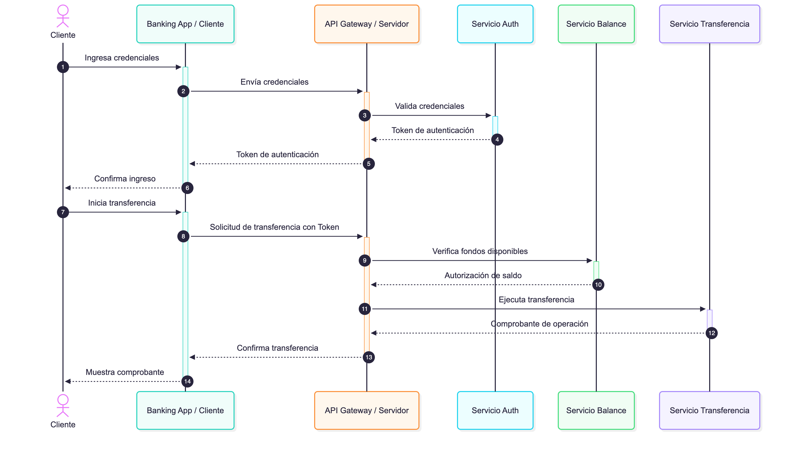

\begin{titlepage}
    \centering
    \includegraphics[width=.3\textwidth]{../../../img/udemm-logo.png}

    \vspace{0.4cm}
    {\Large Facultad de Ingeniería} \\
    \vspace{0.3cm}
    {\large Ingeniería en Sistemas} \\

    \vspace{2.5cm}

    \rule{\linewidth}{0.5mm} \\[0.4cm]
    {\huge \bfseries Trabajo Práctico} \\[0.3cm]
    {\Large Arquitectura SOA} \\[0.2cm]
    \rule{\linewidth}{0.5mm}

    \vfill

    \begin{tabular}{r l}
        \textbf{Asignatura:} & Diseño de Sistemas II \\
        \textbf{Docente:}    & Mg. Daniel Omar García \\
        \textbf{Alumno:}     & Daniel Ise \\
        \textbf{Legajo:}     & 28547 \\
        \textbf{Fecha:}      & Noviembre, 2026 \\
    \end{tabular}
\end{titlepage}

\pagenumbering{roman}
\thispagestyle{empty}
\tableofcontents
\newpage

\pagenumbering{arabic}
\setcounter{page}{1}

# Introducción

El presente trabajo práctico pretende abordar un conjunto de beneficios 
asociados a la Arquitectura Orientada a Servicios —o SOA, por las siglas de su 
nombre en inglés, *Service-Oriented Architecture*—.
Esta arquitectura se basa en  la construcción de aplicaciones mediante la
composición de elementos funcionales autónomos, conocidos como
**servicios**[@garcia2026].
Cada servicio se  *orienta al negocio*, es decir, representa un proceso real
como, por ejemplo, el procesamiento de un pago.
Para la provisión de funciones complejas los  servicios se combinan,
interactuando entre sí mediante *protocolos de  comunicación estándar*, como
`SOAP/HTTP` o `JSON/HTTP`.

El diseño de SOA toma como base en una serie de principios
fundamentales[@garcia2026].
El **bajo acoplamiento** implica que un servicio no necesita conocer las
estructuras de datos, la gestión de transacciones ni el lenguaje de
implementación del resto.
Al reducir las dependencias al mínimo, un cambio en su funcionamiento interno no
afecta a los demás.
La **abstracción** refiere al ocultamiento de la lógica de programación y la
tecnología subyacente, limitándose a exponer únicamente lo necesario para la
interacción a través de un *contrato*.
Asimismo, todo servicio se concibe para ser **reutilizado** en múltiples
aplicaciones o procesos de negocio.
Debe ser **autónomo**, manteniendo el control sobre su propia lógica de
ejecución, datos y entorno.
A estos pilares se suman los conceptos de **statelessness** (no mantener estado
entre llamados para maximizar la escalabilidad);
**descubribilidad** (la capacidad de ser localizados y descritos mediante un
catálogo o registro centralizado) y **composabilidad** (la posibilidad de
orquestar y combinar servicios en procesos de negocio de mayor complejidad).

En el apartado siguiente se analizan los beneficios asociados a la Arquitectura
SOA, incluyendo: la gestión de la seguridad, el *testing*, la mantenibilidad, el
desarrollo paralelo, la escalabilidad, el monitoreo preciso y la
interoperabilidad.

Finalmente, se argumentará sobre la articulación entre SOA y la arquitectura 
Cliente-Servidor.
Ambos enfoques no son mutuamente excluyentes, sino que pueden coexistir en un
mismo sistema, siempre que se respeten los principios propios de cada
arquitectura.
Esto se mostrará con un caso de ejemplo y su diagrama de secuencia en UML.

# Beneficios de la Arquitectura Orientada a Servicios

El diseño de aplicaciones siguiendo SOA ofrece algunas ventajas respecto de una
arquitectura monolítica.
Estas ventajas incluyen:

- Definición de seguridad más clara
- Mayor facilidad para el *testeo*
- Mejora de la mantenibilidad
- Mejora del desarrollo en paralelo
- Facilidad para la escalabilidad
- Monitoreo preciso
- Interoperabilidad

A continuación, se analiza brevemente cada una de estas dimensiones.

## Definición de seguridad más clara

Dwivedi y Rath sostienen que la seguridad representa el mayor desafío en la
implementación de SOA [@dwivedi2015incorporating].
Para estos autores, su naturaleza abierta y distribuida supone una
vulnerabilidad que se vuelve aún más severa en la medida en que sistemas
críticos adoptan este paradigma.
Los autores demuestran que dicho riesgo puede mitigarse con la incorporación de
patrones de seguridad específicos.

SOA permite el crecimiento de la flexibilidad de los sistemas para adaptarse a
requerimientos de negocio cambiantes, pero introduce nuevos riesgos que
requieren la implementación de seguridad basada en políticas y protección de
extremo a extremo para garantizar la autenticación, autorización, encriptación e
integridad de los mensajes que circulan
[@chetty2010towards].

La seguridad es un aspecto crítico en SOA: así como aporta mayor flexibilidad y
capacidad de adaptación, también amplía la superficie de exposición al
distribuir componentes en red.
SOA permite una **definición de seguridad más clara** que un monolito al
desacoplar las políticas de acceso de la lógica de negocio y explicitarlas en
contratos y componentes centralizados (como un ESB), pero ese beneficio depende
de una implementación que atienda la buenas prácticas y los estándares vigentes.

## Facilidad de testeo

Las pruebas en sistemas orientados a servicios deben incluir la verificación
funcional, la interoperabilidad y los ensayos de carga y estrés, con el objetivo
de asegurar la calidad del producto
[@bozkurt2013testing].
Además la adopción de sistemas basados en SOA enfrenta una
dificultad adicional frente a los monolitos tradicionales: demostrar su
fiabilidad al cliente, es decir, garantizar que los servicios seguirán
disponibles en los momentos en que sean requeridos [@bozkurt2013testing].
Este aspecto refuerza la importancia de las pruebas durante el desarrollo y el
despliegue.

A su vez, el testeo de sistemas distribuidos conlleva desafíos propios, pues
debe contemplar su naturaleza compleja y los límites asociados a los protocolos
de comunicación adoptados [@bozkurt2013testing].
En dicho contexto, el monitoreo y la generación automatizada de casos de prueba
emergen como las técnicas principales para asegurar el correcto funcionamiento
de esta clase de arquitecturas [@canfora2006service].

En definitiva, la **facilidad para probar el sistema** resulta ser, nuevamente,
un beneficio condicionado.
Si bien el bajo acoplamiento y los contratos explícitos de SOA facilitan
notablemente las **pruebas unitarias y aisladas** de cada servicio (permitiendo
simular dependencias sin levantar todo el sistema), las pruebas de integración
se vuelven más exigentes.
Estas deben adaptar sus metodologías a la naturaleza distribuida y flexible de
los servicios; solo así es posible garantizar al cliente la confiabilidad de un
monolito, manteniendo a la vez la agilidad para responder a requerimientos de
negocio cambiantes.

## Mejor mantenibilidad

Las estrategias de mantenimiento debieron adaptarse para dar soporte a un
ecosistema dinámico y cambiante como el de los sistemas basados en SOA, donde
proliferan servicios de terceros incorporados a los flujos de trabajo sobre los
cuales existe poco control y menor visibilidad [@lewis2010research]. Tanto las
herramientas como las técnicas de gestión tuvieron que evolucionar frente a
estos nuevos desafíos.

Pese a esta complejidad adicional, la división del sistema en servicios
orientados a procesos de negocio permite acotar las tareas de mantenimiento a
porciones específicas y aisladas.
En contraste con un monolito, el bajo acoplamiento, la abstracción de la lógica
interna y la interacción mediada por contratos permiten a los desarrolladores
introducir modificaciones sin afectar al resto del ecosistema,
**fortaleciendo así la mantenibilidad**.

## Desarrollo en paralelo

Los procesos de negocio de las organizaciones aumentan su complejidad con el
tiempo y, junto con ellos, crece la cantidad de aplicaciones destinadas a
operaciones internas y externas.
Una de las fortalezas de SOA reside en su
capacidad para articular estos componentes.
Sin embargo, el **desarrollo en paralelo** presenta desafíos organizativos
propios.
Para evitar la emergencia de esquemas de gobernanza *ad hoc*, resulta necesario
adoptar un enfoque holístico y una cultura de integración que respalde el
trabajo simultáneo [@hustad2014service].
Atendido este requerimiento, SOA representa un avance significativo: al
delimitar cada servicio mediante contratos explícitos e independientes de su
implementación, distintos equipos pueden construir, probar y evolucionar
servicios de manera autónoma y concurrente sin bloquearse entre sí.

## Fácil escalabilidad

La escalabilidad puede asumir dos modalidades: vertical —incrementar el poder de
cómputo de un único servidor— u horizontal —desplegar nuevas instancias en
paralelo detrás de un balanceador de carga que distribuye el tráfico—
[@razavi2024tale].
Las arquitecturas monolíticas suelen depender del primer enfoque, lo que
representa una limitación crítica dado que el escalado vertical enfrenta límites
físicos y un crecimiento exponencial de costos.
En cambio, SOA se adapta naturalmente al escalado horizontal y granular: gracias
a la autonomía de los servicios y al principio de diseño
*statelessness*[@garcia2026], es posible multiplicar únicamente las instancias
del servicio puntual que enfrenta un pico de demanda, **facilitando la
escalabilidad** del sistema y la respuesta ágil ante los desafíos del negocio.

## Monitoreo preciso

Como se señaló considerando las pruebas en SOA, el monitoreo asume un lugar
privilegiado en la gobernanza de sistemas distribuidos [@canfora2006service].
La naturaleza diferenciada y desacoplada de los sistemas basados en SOA permite
la observabilidad de cada uno de los componentes que forman parte del sistema.
Si se considera que cada servicio responde a un -y solo un- requerimiento de
negocio, podemos concluir que el monitoreo de un sistema centrado en servicios
permite a los tomadores de decisión contar con un **monitoreo preciso** del 
estado del negocio.

Como se señaló al considerar las pruebas en SOA, el monitoreo asume una posición
privilegiada en la gobernanza de sistemas distribuidos [@canfora2006service].
La naturaleza diferenciada y desacoplada de esta arquitectura permite la
observabilidad individual de cada componente mediante contratos estandarizados y
puntos de mediación como el ESB.
Si se considera que cada servicio responde a un —y solo un— requerimiento de
negocio, podemos concluir que la supervisión de un sistema centrado en servicios
brinda a los tomadores de decisión un **monitoreo preciso** y en tiempo real
sobre el desempeño operativo del negocio.

## Interoperabilidad

En la introducción se señalaron los pilares de diseño en SOA, entre los que se 
resaltaron la *composabilidad*, esto es, la capacidad de orquestar servicios
para definir procesos de negocio de mayor complejidad;
el *bajo acoplamiento*, es decir, la autonomía que tienen los servicios para 
funcionar, permitiendo tanto su funcionamiento individual como su coordinación;
y la *reusabilidad*, sobre la base del concepto de *contrato*
[@garcia2026].
Estos principios de diseño constituyen la base natural para la
**interoperabilidad** de sistemas diferenciados, con independencia de sus
detalles de implementación e, inclusive, del *hardware* sobre el que corren
[@vetere2005models].

En la introducción se señalaron los pilares de diseño de SOA, entre los que se 
destacaron la *composabilidad* —la capacidad de orquestar servicios para 
definir procesos de negocio de mayor complejidad—, el *bajo acoplamiento* —la 
autonomía que tienen los servicios para operar tanto de forma individual como 
coordinada— y la *reutilización* sobre la base de contratos explícitos 
[@garcia2026].
Articulados mediante el uso de protocolos y estándares abiertos de comunicación
(como `XML`, `SOAP`, `WSDL` o `HTTP`), estos principios constituyen la base
natural para lograr la **interoperabilidad** entre sistemas heterogéneos, con
independencia de sus lenguajes de implementación e, incluso, del *hardware*
sobre el que se ejecutan [@vetere2005models].

# Arquitectura Cliente-Servidor y Arquitectura Orientada a Servicios

La arquitectura Cliente-Servidor se basa en dos clases de entidades, *clientes*
y *servidores*, que se comunican siguiendo un *ciclo de petición y respuesta*:
el cliente envía una solicitud al servidor, que la procesa y elabora una
respuesta.

Esta arquitectura y SOA no son mutuamente excluyentes; por el contrario, muchas
implementaciones de SOA son sistemas distribuidos web que operan sobre un
esquema Cliente-Servidor [@vetere2005models; @dwivedi2015incorporating; @chetty2010towards].
En este modelo híbrido, ambos paradigmas se articulan mediante la **negociación
de contratos**: el servidor (proveedor de servicio) publica una interfaz
estandarizada —como una especificación `OpenAPI`— donde define operaciones,
formatos de datos y políticas de acceso.
El cliente (consumidor) inspecciona y acuerda dicho contrato para establecer la
comunicación, pudiendo incluso un mismo servicio asumir el rol de servidor
frente a una aplicación frontal y el de cliente al invocar otros servicios
internos.

Un ejemplo concreto de esta integración es el proceso de transferencia en una
aplicación de *home-banking*. La aplicación web o móvil (cliente) envía una
petición `HTTPS` ajustada al contrato expuesto por el bus de servicios o *API
Gateway* (servidor), el cual orquesta de forma transparente los servicios de
*Autenticación*, *Gestión de Cuentas* y *Notificaciones*, tal como se ilustra en
el diagrama de secuencia incluido en el Anexo.

# Anexo

{#fig:secuencia-soa width=100%}

# Bibliografía citada
